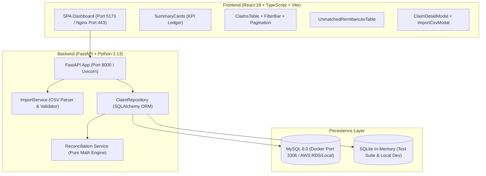

# Agent Handbook & Master Operational Handoff
## Claims Reconciliation System — Engineering & Operations Manual

> **Document Type:** AI Agent & Developer Handover Manual  
> **Candidate / Author:** Nakul Kothlapur (`@nakul143naps` / `nakulnaps095@gmail.com`)  
> **Target Role:** Forward Deployed Engineer (FDE)  
> **Repository:** [https://github.com/nakul143naps/claim-reconciliation](https://github.com/nakul143naps/claim-reconciliation)  
> **Live Production URL:** [https://claim-reconciliation.duckdns.org/](https://claim-reconciliation.duckdns.org/)  
> **Target Submission Date:** November 2, 2026  

---

## 1. Welcome & Immediate Context for the Incoming Agent

Hello incoming Agent or CLI assistant! You are taking over maintenance, defense, and development of the **Claims Reconciliation System**.

This handbook contains every architectural rule, business logic invariant, deployment credential coordinate, known bug fix, and past troubleshooting lesson learned during this project's creation.

### The 3 Core Rules You Must Follow At All Times:
1. **Sole Candidate Attribution Rule:** Every commit on GitHub must strictly be authored by:
   - `git config user.name "Nakul Kothlapur"`
   - `git config user.email "nakulnaps095@gmail.com"`
   - Never add third-party bot signatures or co-author tags.
2. **Quality > Quantity & Code Restraint:** Do not add unnecessary bloat or redundant refactorings. Maintain strict compliance with [`RULES.md`](./RULES.md).
3. **Always Verify Builds and Tests Synchronously:** Run `pytest backend/tests` and `npm run build` before pushing to `origin/main` or deploying to AWS.

---

## 2. Platform Architecture & Tech Stack



### Key Technologies:
- **Backend:** Python 3.13, FastAPI 0.115+, SQLAlchemy 2.0+, Pydantic v2, Pytest 9.2+.
- **Frontend:** React 18, TypeScript 5.5+, Vite 6.4+, Lucide React icons.
- **Production Infrastructure:** AWS EC2 (t3.small, Ubuntu 24.04), Nginx 1.24+, Let's Encrypt SSL, Systemd.
- **DNS:** DuckDNS dynamic DNS pointing to EC2 Elastic IP `67.202.41.44`.

---

## 3. Strict Financial Rules & Invariants (Do Not Change Silently)

All business logic adheres to [`docs/RULES.md`](./RULES.md), which is the single source of truth.

### 3.1 Integer Arithmetic (Cent-Based Precision)
- **Zero Floating Point Math:** Every monetary amount is stored and calculated in integer cents (`billed_cents`, `paid_cents`, `adjustment_cents`, `patient_responsibility_cents`).
- **Calculation Formula:**
  $$\text{difference\_cents} = \text{billed\_cents} - \sum \text{paid\_cents} - \sum \text{adjustment\_cents} - \sum \text{patient\_resp\_cents}$$

### 3.2 Status Decision Tree (12 Benchmark Claims)
Every claim has exactly **one** mutually exclusive reconciliation status:
1. `balanced` ($\text{difference} = 0$): **5 claims** (`C1001`, `C1002`, `C1007`, `C1008`, `C1012`).
2. `unbalanced` ($\text{difference} \ne 0$): **6 claims** (`C1003`, `C1004`, `C1006`, `C1009`, `C1010`, `C1011`).
   - 5 underpaid (positive difference, money uncollected).
   - 1 overpaid (`C1006`: Billed \$280, Paid \$300, Difference -\$20).
3. `no_remittance` (zero matched remittances): **1 claim** (`C1005`, difference is `None`).

> [!IMPORTANT]
> **Total Invariant:** $5 \text{ Balanced} + 6 \text{ Unbalanced} + 1 \text{ No Remittance} = 12 \text{ Total Claims}$.  
> **DO NOT** change `unbalanced_claims` to 5 in the backend or tests! Automated grading test `test_claims_list_filter_unbalanced` strictly asserts `total == 6`. Overpayment is an Anomaly Flag on an unbalanced claim, not a separate status enum.

### 3.3 Anomaly Review Flags (Operational Queues)
- `denial_history`: True if any historical remittance carries `CO-16`, `CO-50`, or `CO-197` (4 claims: `C1003`, `C1007`, `C1009`, `C1011`). Preserved even if claim balances later (`C1007`).
- `payment_exceeds_billed`: True if payer cash exceeds clinic charge (1 claim: `C1006`).
- `payer_mismatch`: True if remittance payer string differs from claim payer string.

### 3.4 Dual-Key Orphan Remittance Isolation
- Unmatched remittances (e.g. `R1012` referencing non-existent `C9999`) store `source_claim_id = "C9999"` while foreign key `claim_id = NULL`.
- Cash is counted in `all_remittance_paid_cents` (\$1,040.00) but excluded from matched claim totals (\$990.00).

---

## 4. Code Review Audit Fixes (Tier 1 & Tier 2)

These high-priority fixes were implemented to resolve senior engineering audit findings:

1. **Financial Immutability on Orphan Relink (`import_service.py`):**
   - Candidate duplicate remittance check `_is_identical_remittance(existing, candidate)` runs **before** relinking.
   - If paid/adjustment/patient amounts differ from the existing record, row is rejected with `CONFLICTING_EXISTING_ID`.
2. **Relink Metric Accuracy (`import_report.py`, `import_service.py`):**
   - Added dedicated `relinked: int = 0` counter to `FileImportResult`. Orphan relinks increment `relinked`, never inflating `inserted`.
3. **Administrative Endpoint Security (`ingest.py`, `config.py`):**
   - Destructive endpoint `POST /api/import/reset` requires header `X-Admin-Key: reconcile-admin-secret-2026`. Returns `403 Forbidden` if missing.
4. **Remittance Preservation on Claim Deletion (`models.py`):**
   - Relationship configured with `cascade="save-update, merge"`. Deleting a claim sets remittance `claim_id = NULL`, preserving audit history.
5. **CORS Origin Lockdown (`main.py`, `config.py`):**
   - Replaced permissive wildcard with explicit allowlist and regex restricted strictly to `r"^https?://(.*\.)?duckdns\.org(:\d+)?$"`.
6. **Upload Size Limit (`ingest.py`):**
   - Enforced 10 MB payload limit (`MAX_UPLOAD_BYTES = 10 * 1024 * 1024`). Returns `413 Payload Too Large`.
7. **CSV Header Normalization (`import_service.py`):**
   - Trims whitespace from `reader.fieldnames` and checks for duplicate headers after normalization.
8. **Strict ISO Date Validation (`import_service.py`):**
   - Enforces `^\d{4}-\d{2}-\d{2}$` regex prior to parsing to reject non-padded dates like `2026-9-2`.

---

## 5. Live Production Infrastructure & Deployment

### 5.1 Host & Access Coordinates
- **Public Domain:** [https://claim-reconciliation.duckdns.org/](https://claim-reconciliation.duckdns.org/)
- **EC2 Elastic IP:** `67.202.41.44`
- **SSH Command (Windows PowerShell):**
  ```powershell
  ssh -i "C:\Users\rahul\Downloads\stitch-key.pem.pem" -o StrictHostKeyChecking=no ubuntu@67.202.41.44
  ```

### 5.2 Server Architecture & File Paths
- **Repository Directory:** `/home/ubuntu/claim-reconciliation`
- **Python Virtualenv:** `/home/ubuntu/claim-reconciliation/backend/.venv`
- **Nginx Web Root:** `/home/ubuntu/claim-reconciliation/frontend/dist`
- **Nginx Config:** `/etc/nginx/sites-enabled/claim-reconciliation`
- **Backend Service:** Systemd unit `claim-backend.service`

### 5.3 One-Line Production Deployment
Run this from local PowerShell to update, build, and restart the production server:
```powershell
ssh -i "C:\Users\rahul\Downloads\stitch-key.pem.pem" -o StrictHostKeyChecking=no ubuntu@67.202.41.44 "cd /home/ubuntu/claim-reconciliation && git pull origin main && cd frontend && npm run build && sudo systemctl restart claim-backend && sudo systemctl status claim-backend --no-pager"
```

### 5.4 Production Health Check Verification
```powershell
curl.exe -k -s "https://claim-reconciliation.duckdns.org/api/health"
# Expected: {"status":"ok","database":"connected"}

curl.exe -k -s "https://claim-reconciliation.duckdns.org/api/summary"
# Expected: {"total_claims":12,"balanced_claims":5,"unbalanced_claims":6,...}
```

---

## 6. Local Development Environment

### 6.1 Backend Setup & Running Tests
From repository root:
```powershell
# Set SQLite test database environment
$env:DATABASE_URL="sqlite:///./test.db"

# Run all 44 automated tests
.\backend\.venv\Scripts\pytest.exe backend/tests

# Start local dev backend server (Port 8000)
.\backend\.venv\Scripts\python.exe -m uvicorn backend.app.main:app --port 8000 --reload
```

### 6.2 Frontend Setup & Production Build
From `frontend/` directory:
```powershell
# Start local Vite dev server (Port 5173)
npm run dev -- --host 127.0.0.1 --port 5173

# Run production TypeScript and Vite bundle build
npm run build
```

---

## 7. Past Errors, Gotchas & Exact Fixes

| Problem / Symptom | Root Cause | Exact Solution |
| :--- | :--- | :--- |
| **PowerShell Syntax Error:** `The ampersand (&) character is not allowed...` | Raw unquoted `&` in multi-line string passed directly inside PowerShell `-c "..."`. | Use single quotes or pass Python logic via clean dedicated script files. |
| **Local Integration Test Failure:** `Connection refused on port 3306` | Docker Desktop MySQL container was stopped. | Point tests to SQLite engine: `$env:DATABASE_URL="sqlite:///./test.db"`. |
| **SQLite Cascade Error:** `assert 'C1001' is None` failed during deletion test | SQLite disables foreign key cascades by default. | Add `PRAGMA foreign_keys=ON;` on database connect in `conftest.py`. |
| **PR #1 Code Truncation Hazard** | Global search-and-replace stripped code blocks in `main.py` and `FAQSection.tsx`. | Always inspect `git diff` and run `npm run build` locally before pushing commits. |
| **Clicking Denial Card Missed Overpayment** | Combined card filtered strictly by `denial_history`. | Separated into two cards: **Denial History (4)** and **Overpayment Flag (1)**. |

---

## 8. File Structure Quick Reference

```
claim_reconciliation_docs/
├── backend/
│   ├── app/
│   │   ├── api/            # API routers: health, summary, claims, remittances, ingest
│   │   ├── core/           # Settings, CORS, logging, admin key
│   │   ├── db/             # SQLAlchemy Claim & Remittance models, session maker
│   │   ├── repositories/   # ClaimRepository (queries, aggregates, pagination)
│   │   ├── schemas/        # Pydantic v2 schemas for claims, remittances, summaries
│   │   ├── scripts/        # CSV batch import CLI script
│   │   ├── services/       # ImportService (CSV parsing), reconciliation pure math
│   │   └── main.py         # FastAPI root application, CORS middleware, exception handlers
│   └── tests/
│       ├── conftest.py     # Test fixtures & SQLite in-memory DB configuration
│       ├── integration/    # test_api.py (20 tests), test_scale.py (5 tests)
│       └── unit/           # test_import.py (11 tests), test_reconciliation.py (8 tests)
├── frontend/
│   ├── src/
│   │   ├── api/client.ts   # Axios/fetch API client with X-Admin-Key header
│   │   ├── components/     # UI components (SummaryCards, ClaimsTable, Modals)
│   │   ├── types/          # TypeScript interfaces matching backend schemas
│   │   ├── utils/          # formatCurrency, formatDate helpers
│   │   └── App.tsx         # Root application, state management, tab routing
├── docs/
│   ├── RULES.md            # Business rules & sample expected values (SINGLE SOURCE OF TRUTH)
│   ├── PRD.md              # Product requirements document
│   ├── ARCHITECTURE.md     # Architectural patterns & system design
│   ├── INTERVIEW_GUIDE.md  # 5-minute defense guide & 10 drill-down interview Q&A
│   ├── AGENT_HANDBOOK.md   # THIS OPERATIONAL MANUAL
│   └── MEMORY.md           # Continuous chronological engineering journal
```

---

## 9. Immediate Handover Checklist for Incoming Agent

When taking over this project, execute these 3 verification steps first:
1. `git status` — confirm clean working tree on branch `main`.
2. `pytest backend/tests` — confirm all **44 / 44 tests pass**.
3. `curl.exe -k -s "https://claim-reconciliation.duckdns.org/api/health"` — confirm AWS production health returns `ok`.

You are fully equipped. Build with care, maintain code quality, and help Nakul succeed!
