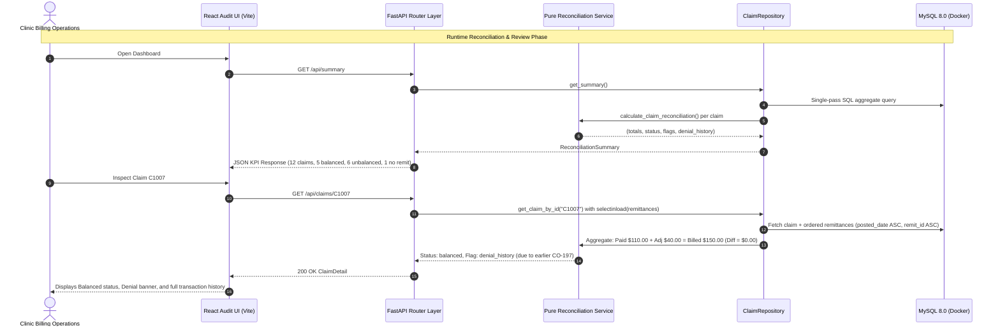

# Stitch Financial — Forward Deployed Engineer (FDE) Comprehensive Defense & Architecture Guide

> **Candidate**: Nakul Kothlapur  
> **Role**: Forward Deployed Engineer (FDE)  
> **Company**: Stitch Fin  
> **Project**: Enterprise Healthcare Claim Reconciliation Engine  
> **Live Production AWS URL**: [http://67.202.41.44](http://67.202.41.44)  
> **GitHub Repository**: [https://github.com/nakul143naps/claim-reconciliation](https://github.com/nakul143naps/claim-reconciliation)  

---

## Table of Contents
1. [The 5-Minute Codebase Walkthrough](#1-the-5-minute-codebase-walkthrough)
2. [Architectural Guardrails & Engineering Invariants](#2-architectural-guardrails--engineering-invariants)
3. [File-by-File Technical Deep Dive](#3-file-by-file-technical-deep-dive)
4. [The Interview Coding Challenge Navigator ("Where & How to Change")](#4-the-interview-coding-challenge-navigator-where--how-to-change)
5. [Top 10 Technical Drill-Down Questions & Bulletproof Answers](#5-top-10-technical-drill-down-questions--bulletproof-answers)
6. [Top 10 SQL Queries for Billing Operations](#6-top-10-sql-queries-for-billing-operations)
7. [Healthcare RCM Terminology Primer](#7-healthcare-rcm-terminology-primer)
8. [Production Roadmap (What I Would Build Next)](#8-production-roadmap-what-i-would-build-next)
9. [Automated Testing & Scale Verification](#9-automated-testing--scale-verification)

---

## 1. The 5-Minute Codebase Walkthrough

When an interviewer asks: *"Nakul, walk me through what you built and how the architecture works,"* follow this structured 5-minute narrative:


### Minute 1: The Healthcare Domain & Problem
> *"In healthcare revenue cycle management (RCM), providers submit medical claims to insurance payers, but remittance advices (ERA 835s) return in separate, asynchronous batches. A single claim might receive multiple partial payments, contractual fee-schedule write-offs, or denials over months. Worse, payment files frequently arrive for claims not yet in the clinic's local records.*
> *The engineering challenge is building a deterministic engine that accurately accounts for every penny, preserves historical denials even after a claim balances out, isolates orphaned cash without creating phantom records, and scales to thousands of records with zero latency degradation."*

### Minute 2: Non-Negotiable Architectural Invariants
> *"I designed the architecture around three strict engineering principles:*
> 1. **Authoritative Backend**: *All mathematical formulas, reconciliation statuses (`balanced`, `unbalanced`, `no_remittance`), and operational review flags are computed on the server. The frontend never computes financial balances.*
> 2. **Absolute Integer Precision**: *Zero floating-point arithmetic. Every dollar figure is stored and computed in integer cents (`BigInteger` in MySQL, `int` in Python/TypeScript) to eliminate IEEE 754 precision drift.*
> 3. **Dual-Key Orphan Isolation**: *Remittances that reference an unknown claim are stored with their raw string in `source_claim_id`, while the foreign key `claim_id` is set to `NULL`. This keeps cash accounted for in executive totals without corrupting claim-level accounting."*

### Minute 3: Data Access & Scale (Solving the N+1 Problem)
> *"For high performance, the data layer uses two distinct query strategies:*
> - *For the executive dashboard (`/api/summary`), I push calculations into MySQL using single-pass conditional aggregation (`SUM(CASE WHEN ...)`), avoiding loading thousands of rows into application memory.*
> - *For the claims ledger (`/api/claims`), I use SQLAlchemy's `selectinload(Claim.remittances)`. This completely eliminates the N+1 query problem by executing exactly two queries—one for the paginated claims and one batched `WHERE claim_id IN (...)` query—merging them in memory in $O(N)$ time."*

### Minute 4: Resilient Ingestion Pipeline
> *"The ingestion pipeline (`ImportService`) is built for messy client data:*
> - *It performs fail-fast header validation before any DB interaction.*
> - *Each row is wrapped in a SQL Savepoint (`db.begin_nested()`). If row 42 has corrupted data, only that row is rolled back with an actionable error report; valid rows commit cleanly.*
> - *It features bi-directional auto-relinking: when new claims arrive, any orphan remittances that were waiting for them are automatically linked in the same transaction."*

### Minute 5: Frontend Experience & Production Deployment
> *"The frontend is a modular React 18 TypeScript application built with clean component boundaries (filter bar, pagination controls, progress bars, denial appeal playbooks, and audit export).*
> *The entire system is backed by 38 automated unit, integration, and scale tests, containerized via Docker, and deployed live in production on an AWS EC2 instance behind an Nginx reverse proxy."*

---

## 2. Architectural Guardrails & Engineering Invariants



### Core Accounting Formulas
1. **Financial Difference**:
   $$\text{difference\_cents} = \text{billed\_cents} - \text{paid\_cents} - \text{adjustment\_cents} - \text{patient\_responsibility\_cents}$$
2. **Reconciliation Statuses**:
   - `balanced`: $\text{difference\_cents} == 0$ with at least 1 matched remittance.
   - `unbalanced`: $\text{difference\_cents} \neq 0$ with at least 1 matched remittance.
   - `no_remittance`: 0 matched remittances. Difference is explicitly `None` (not 0, not billed).
3. **Denial History**:
   - Evaluated across all historical remittances. If reason code is `CO-16`, `CO-50`, or `CO-197`, flag `denial_history` is preserved even after the claim becomes `balanced`.
4. **Dual-Key Orphan Isolation**:
   - `source_claim_id`: Raw string from payer (e.g. `C9999`).
   - `claim_id`: Nullable foreign key (`NULL` if claim missing). Preserves cash in `all_remittance_paid_cents` while excluding from claim balances.

---

## 3. File-by-File Technical Deep Dive

### 3.1 Backend Architecture

| File | Purpose | Key Functions / Methods | Design Highlights |
| :--- | :--- | :--- | :--- |
| [`backend/app/services/reconciliation.py`](file:///C:/Users/rahul/OneDrive/Desktop/rules_project/claim_reconciliation_docs/backend/app/services/reconciliation.py) | Pure mathematical calculation engine | `calculate_claim_reconciliation()`<br>`normalize_code()` | Zero DB/network dependencies. Pure, deterministic, unit-testable in microseconds. |
| [`backend/app/repositories/claim_repository.py`](file:///C:/Users/rahul/OneDrive/Desktop/rules_project/claim_reconciliation_docs/backend/app/repositories/claim_repository.py) | Data access, eager loads, pagination, SQL aggregations | `get_summary()`<br>`get_claims_paginated()`<br>`get_claim_by_id()`<br>`get_unmatched_remittances()` | Solves N+1 using `selectinload(Claim.remittances)`. Pushes math into MySQL using `func.sum(case(...))`. |
| [`backend/app/services/import_service.py`](file:///C:/Users/rahul/OneDrive/Desktop/rules_project/claim_reconciliation_docs/backend/app/services/import_service.py) | CSV parsing, atomic validation, orphan relinking | `_validate_headers()`<br>`_parse_claim_row()`<br>`_handle_claim_duplicate()`<br>`_relink_orphan_remittances()` | Fail-fast headers. Row-level SQL Savepoints (`db.begin_nested()`). Auto-relinks waiting orphans on claim insert. |
| [`backend/app/services/export_service.py`](file:///C:/Users/rahul/OneDrive/Desktop/rules_project/claim_reconciliation_docs/backend/app/services/export_service.py) | Formats reconciliation ledger exports | `generate_reconciliation_csv()`<br>`generate_reconciliation_json()` | Dedicated export service keeping file serialization separated from repository queries. |
| [`backend/app/db/models.py`](file:///C:/Users/rahul/OneDrive/Desktop/rules_project/claim_reconciliation_docs/backend/app/db/models.py) | Declarative ORM models | `Claim`<br>`Remittance` | `BigInteger` for cents. Non-negative `CheckConstraint`. Dual claim ID fields (`source_claim_id` and nullable FK `claim_id`). |
| [`backend/app/main.py`](file:///C:/Users/rahul/OneDrive/Desktop/rules_project/claim_reconciliation_docs/backend/app/main.py) | FastAPI app entrypoint, CORS, exception handlers | `validation_exception_handler()`<br>`http_exception_handler()`<br>`lifespan()` | Unified error envelopes (`{"error": {"code": "...", "message": "..."}}`). Safe 500 handler hiding internal tracebacks. |
| [`backend/app/api/claims.py`](file:///C:/Users/rahul/OneDrive/Desktop/rules_project/claim_reconciliation_docs/backend/app/api/claims.py) | Claims REST endpoints | `list_claims()`<br>`get_claim()`<br>`export_claims()` | Payer/status/flag/substring filters. Supports 10/20/50 pagination and streaming CSV/JSON export. |
| [`backend/app/api/ingest.py`](file:///C:/Users/rahul/OneDrive/Desktop/rules_project/claim_reconciliation_docs/backend/app/api/ingest.py) | CSV batch ingestion & benchmark reset | `upload_claims_csv()`<br>`upload_remittances_csv()`<br>`reset_to_benchmark()` | Multi-part form parsing, UTF-8-SIG decoding, template download triggers. |

### 3.2 Frontend Architecture

| Component / Module | Purpose | Key Mechanics |
| :--- | :--- | :--- |
| [`frontend/src/App.tsx`](file:///C:/Users/rahul/OneDrive/Desktop/rules_project/claim_reconciliation_docs/frontend/src/App.tsx) | Root state orchestrator | Manages tab views (`hub` vs `unmatched`), data fetching callbacks (`loadSummaryData`, `loadClaimsData`), modal states, and global alerts. |
| [`frontend/src/api/client.ts`](file:///C:/Users/rahul/OneDrive/Desktop/rules_project/claim_reconciliation_docs/frontend/src/api/client.ts) | Centralized typed HTTP client | Wraps `fetch()`, serializes query parameters, unwraps `{ error: { code, message } }` API error envelopes. |
| [`frontend/src/components/ClaimsTable.tsx`](file:///C:/Users/rahul/OneDrive/Desktop/rules_project/claim_reconciliation_docs/frontend/src/components/ClaimsTable.tsx) | Focused claims table view | Renders data rows, status badges, and action triggers; delegates controls to sub-components. |
| [`frontend/src/components/ClaimsFilterBar.tsx`](file:///C:/Users/rahul/OneDrive/Desktop/rules_project/claim_reconciliation_docs/frontend/src/components/ClaimsFilterBar.tsx) | Multi-filter toolbar | Search input, payer filter, status filter, flag filter, 1-click Reset, and export dropdown. |
| [`frontend/src/components/ClaimsPaginationBar.tsx`](file:///C:/Users/rahul/OneDrive/Desktop/rules_project/claim_reconciliation_docs/frontend/src/components/ClaimsPaginationBar.tsx) | Pagination toolbar | Page navigation buttons, entries per page selector (`10 / 20 / 50`), and record count labels. |
| [`frontend/src/components/SummaryCards.tsx`](file:///C:/Users/rahul/OneDrive/Desktop/rules_project/claim_reconciliation_docs/frontend/src/components/SummaryCards.tsx) | Executive KPI cards | 5 metric cards rendered via unified `<KpiCardItem />` helper. |
| [`frontend/src/components/FinancialSettlementProgressBar.tsx`](file:///C:/Users/rahul/OneDrive/Desktop/rules_project/claim_reconciliation_docs/frontend/src/components/FinancialSettlementProgressBar.tsx) | Visual recovery rate | Multi-segment bar: Cash Received, Contract Adjustments & Copays, Amount Not Yet Received. |
| [`frontend/src/components/ClaimDetailModal.tsx`](file:///C:/Users/rahul/OneDrive/Desktop/rules_project/claim_reconciliation_docs/frontend/src/components/ClaimDetailModal.tsx) | Audit drawer modal | Slide-over inspector embedding `<DenialAppealPlaybook />` and `<RemittanceTimelineTable />`. |
| [`frontend/src/components/DenialAppealPlaybook.tsx`](file:///C:/Users/rahul/OneDrive/Desktop/rules_project/claim_reconciliation_docs/frontend/src/components/DenialAppealPlaybook.tsx) | CARC appeal guidance | Explains denial codes (`CO-16`, `CO-50`, `CO-197`) with 1-click clipboard appeal letter copy. |
| [`frontend/src/components/RemittanceTimelineTable.tsx`](file:///C:/Users/rahul/OneDrive/Desktop/rules_project/claim_reconciliation_docs/frontend/src/components/RemittanceTimelineTable.tsx) | Historical remittance ledger | Ordered transaction timeline displaying amounts, dates, and CARC explanations. |
| [`frontend/src/components/ImportCsvModal.tsx`](file:///C:/Users/rahul/OneDrive/Desktop/rules_project/claim_reconciliation_docs/frontend/src/components/ImportCsvModal.tsx) | CSV batch ingestion modal | Drag-and-drop dropzones for claims/remittances, benchmark reset, and `<ImportReportCard />`. |
| [`frontend/src/components/UnmatchedRemittancesTable.tsx`](file:///C:/Users/rahul/OneDrive/Desktop/rules_project/claim_reconciliation_docs/frontend/src/components/UnmatchedRemittancesTable.tsx) | Orphan review queue | Quarantined queue for remittances referencing missing claims. |

---

## 4. The Interview Coding Challenge Navigator ("Where & How to Change")

If an interviewer asks: *"Can you make a change in the code to do X?"*, use this exact index to name the file, line number, and modifications:

```
┌────────────────────────────────────────────────────────────┬──────────────────────────────────────────────────────────────────┐
│ IF THE INTERVIEWER ASKS YOU TO:                            │ EXACT FILE & LINES TO CHANGE:                                    │
├────────────────────────────────────────────────────────────┼──────────────────────────────────────────────────────────────────┤
│ 1. Add a new CARC Denial Code (e.g. CO-4 or CO-96)         │ backend/app/services/reconciliation.py (Line 12)                 │
│                                                            │ frontend/src/utils/formatters.ts (Lines 5-12)                    │
│                                                            │ frontend/src/components/DenialAppealPlaybook.tsx (Line 14)       │
├────────────────────────────────────────────────────────────┼──────────────────────────────────────────────────────────────────┤
│ 2. Add a new Reconciliation Status (e.g. 'partially_paid') │ backend/app/services/reconciliation.py (Lines 47-48)             │
│                                                            │ backend/app/api/claims.py (Lines 16-19)                          │
│                                                            │ frontend/src/types/index.ts (Lines 29, 41)                       │
│                                                            │ frontend/src/components/StatusBadge.tsx (Lines 10-35)            │
├────────────────────────────────────────────────────────────┼──────────────────────────────────────────────────────────────────┤
│ 3. Add a new Review Flag (e.g. 'timely_filing_exceeded')   │ backend/app/services/reconciliation.py (Lines 55-66)             │
│                                                            │ backend/app/api/claims.py (Lines 22-26)                          │
│                                                            │ frontend/src/components/FlagBadge.tsx (Lines 10-40)              │
├────────────────────────────────────────────────────────────┼──────────────────────────────────────────────────────────────────┤
│ 4. Add a new Filter to Claims Table (e.g. Filter by CPT)   │ backend/app/repositories/claim_repository.py (Lines 174-195)     │
│                                                            │ backend/app/api/claims.py (Lines 28-57)                          │
│                                                            │ frontend/src/api/client.ts (Lines 103-121)                       │
│                                                            │ frontend/src/components/ClaimsFilterBar.tsx (Lines 5-37, 82-105) │
│                                                            │ frontend/src/App.tsx (Lines 30-35, 60-80)                        │
├────────────────────────────────────────────────────────────┼──────────────────────────────────────────────────────────────────┤
│ 5. Change the Core Accounting / Variance Formula           │ backend/app/services/reconciliation.py (Line 46)                 │
├────────────────────────────────────────────────────────────┼──────────────────────────────────────────────────────────────────┤
│ 6. Support Flexible / Alternate CSV Column Headers         │ backend/app/services/import_service.py (Lines 17-35, 103-111)    │
├────────────────────────────────────────────────────────────┼──────────────────────────────────────────────────────────────────┤
│ 7. Add Pagination to Unmatched Remittances Queue           │ backend/app/repositories/claim_repository.py (Lines 279-301)     │
│                                                            │ backend/app/api/remittances.py (Lines 13-18)                     │
│                                                            │ frontend/src/components/UnmatchedRemittancesTable.tsx            │
├────────────────────────────────────────────────────────────┼──────────────────────────────────────────────────────────────────┤
│ 8. Add a new KPI Metric Card (e.g. Denial Count)           │ backend/app/schemas/summary.py (Lines 6-37)                      │
│                                                            │ backend/app/repositories/claim_repository.py (Lines 48-86, 123)  │
│                                                            │ frontend/src/types/index.ts (Lines 54-70)                        │
│                                                            │ frontend/src/components/SummaryCards.tsx (Lines 80-160)          │
├────────────────────────────────────────────────────────────┼──────────────────────────────────────────────────────────────────┤
│ 9. Add Authentication / Bearer Token Header Check          │ backend/app/main.py or create backend/app/api/deps.py            │
│                                                            │ Inject `Depends(verify_token)` into router endpoints             │
│                                                            │ frontend/src/api/client.ts (Lines 24-35 - add Authorization)     │
├────────────────────────────────────────────────────────────┼──────────────────────────────────────────────────────────────────┤
│ 10. Add an Audit Log Table for Reviewed Claims             │ backend/app/db/models.py (Add class ClaimAuditLog)               │
│                                                            │ backend/app/repositories/claim_repository.py (Add log method)    │
│                                                            │ backend/app/api/claims.py (Add POST /api/claims/{id}/review)     │
└────────────────────────────────────────────────────────────┴──────────────────────────────────────────────────────────────────┘
```

---

## 5. Top 10 Technical Drill-Down Questions & Bulletproof Answers

### Q1: *"Why did you store currency as integer cents instead of `FLOAT` or `DECIMAL`?"*
> *"Floats represent numbers in binary fractional form (IEEE 754), which cannot precisely represent decimal fractions like 0.10 or 0.01 (e.g., `0.1 + 0.2 = 0.30000000000000004`). In financial ledgers, penny rounding discrepancies can cause false dispute flags and fail audits. By using integer cents (`BigInteger` in MySQL, `int` in Python/TypeScript), addition and subtraction are 100% exact. Division only occurs at presentation time in the UI, avoiding any mathematical drift."*

### Q2: *"How did you prevent the N+1 query problem on the claims list endpoint?"*
> *"In naive ORMs, iterating through 1,000 claims and accessing `claim.remittances` triggers 1 query for the claims plus 1,000 secondary queries (1,001 database roundtrips). In `ClaimRepository.get_claims_paginated`, I explicitly configured `query.options(selectinload(Claim.remittances))`. SQLAlchemy issues exactly two SQL queries: one for the paginated claims and one bulk query using `WHERE claim_id IN (...)`, merging them in memory. Our API response time stays flat under scale."*

### Q3: *"How do you handle remittance `R1012` referencing missing claim `C9999`?"*
> *"In real-world billing, payers frequently send payment advices for claims that were submitted under an alternate clearinghouse ID, a paper claim, or prior to an EHR migration. Discarding the row loses cash reconciliation; creating a dummy claim invents phantom accounts receivable. I solved this with a **dual-column schema**: `source_claim_id` preserves the raw string from the payer, while `claim_id` is a nullable foreign key set to `NULL`. The $50.00 cash is queryable in `/api/remittances/unmatched` and counted in `all_remittance_paid_cents`, but strictly excluded from matched claims so it never skews claim differences."*

### Q4: *"Explain why claim `C1007` is marked `balanced` but still displays a `denial_history` flag."*
> *"This is a crucial distinction between **financial balance** and **operational history**. In the source data, `C1007` was billed for $150.00. The payer first sent remittance `R1006` with $0 paid and denial code `CO-197` (precertification absent). Later, after the clinic corrected authorization, the payer issued remittance `R1007` paying $110.00 with a $40.00 contractual adjustment (`CO-45`). Mathematically: $150.00 - $110.00 - $40.00 = $0.00, so the status is `balanced`. Operationally, billing teams need to know this claim had a denial because repeat denials indicate systemic authorization leakage. Our engine aggregates **all** remittance rows, keeping denial history visible while reflecting the true current balance."*

### Q5: *"Why does claim `C1005` have a `null` difference instead of $60.00?"*
> *"Treating a claim without remittances as having a $60.00 'outstanding balance' is an accounting anti-pattern. If a claim was never acknowledged or adjudicated by the payer, you do not yet know if it will be paid in full, discounted by contract, or denied. Our business rule sets `status = no_remittance` and `difference_cents = null`. The UI explicitly displays an unreceived state rather than claiming it is a verified collectible receivable."*

### Q6: *"How does your import service guarantee idempotency?"*
> *"In client deployments, batch files are frequently re-transmitted by automated cron jobs. Our `ImportService` implements a three-tier idempotency strategy: 1. **Exact Duplicate No-Op**: If a record arrives with identical normalized field values, it is skipped cleanly as `duplicate_noop`. 2. **Conflicting Existing ID**: If an incoming row shares an existing ID but has conflicting values (e.g. altered billed amount), it is rejected as `conflicting_existing_id` with an actionable row-level error. 3. **Row-Level Savepoints**: Each row is wrapped in `db.begin_nested()`, ensuring an invalid row never leaves partial state while allowing valid rows to commit."*

### Q7: *"What did you do about API error consistency?"*
> *"FastAPI out of the box returns `{"detail": [...]}` for query/body validation (422) and plain text for HTTP exceptions. To maintain a strict API contract, I added custom exception handlers for `RequestValidationError`, `HTTPException`, and unhandled server errors (500). All errors conform to a unified schema: `{"error": {"code": "...", "message": "..."}}`. Crucially, internal exception tracebacks, DB connection strings, and server paths are logged internally and never exposed to the client in 500 responses."*

### Q8: *"Why did you build the reconciliation as a pure function instead of putting it on the SQLAlchemy model?"*
> *"By designing `calculate_claim_reconciliation` as a pure, stateless function with zero database dependencies, I separated business logic from persistence. This allows our test suite to test dozens of complex multi-remittance combinations in sub-milliseconds without spinning up database transactions. It also ensures that if we ever swap database engines or run batch jobs in PySpark or Celery, the core accounting logic remains 100% reusable."*

### Q9: *"How does auto-relinking work when a missing claim is eventually imported?"*
> *"When new claims are inserted, `_relink_orphan_remittances(new_claim_ids)` queries `remittances` where `claim_id IS NULL` and `source_claim_id IN (new_claim_ids)`. It automatically updates their foreign key (`remit.claim_id = remit.source_claim_id`) in the same database transaction. No manual intervention or re-import is needed."*

### Q10: *"As a Forward Deployed Engineer, what would you build next in production?"*
> *"1. **Streaming EDI 835 / 837 Parser**: Move from CSV to chunked streaming ANSI X12 835 and 837 transaction sets to handle 500MB+ daily files without memory spikes.  
> 2. **Distributed Job Workers (Celery / Temporal)**: Decouple file ingestion into asynchronous background tasks with progress bars and webhooks notifying clinic EHRs.  
> 3. **Role-Based Access Control (RBAC) & HIPAA Audit Trails**: Implement immutable audit event logging capturing who reviewed or adjusted each claim.  
> 4. **AI-Assisted Denial Appeal Assistant**: Integrate LLM agents to draft appeal letters automatically when codes like CO-16 or CO-197 appear, referencing clinic EHR clinical notes."*

---

## 6. Top 10 SQL Queries for Billing Operations

Here are the exact SQL queries used by the platform:

```sql
-- 1. Single-Pass Remittance Aggregation (Summary KPIs)
SELECT 
    COALESCE(SUM(paid_cents), 0) AS all_paid,
    COALESCE(SUM(CASE WHEN claim_id IS NOT NULL THEN paid_cents ELSE 0 END), 0) AS matched_paid,
    COALESCE(SUM(CASE WHEN claim_id IS NULL THEN 1 ELSE 0 END), 0) AS orphan_count,
    COALESCE(SUM(CASE WHEN claim_id IS NULL THEN paid_cents ELSE 0 END), 0) AS orphan_paid,
    COALESCE(SUM(CASE WHEN claim_id IS NOT NULL THEN adjustment_cents ELSE 0 END), 0) AS matched_adj,
    COALESCE(SUM(CASE WHEN claim_id IS NOT NULL THEN patient_responsibility_cents ELSE 0 END), 0) AS matched_pt_resp
FROM remittances;

-- 2. Claim-Level Variance & Reconciliation Ledger
SELECT 
    c.claim_id,
    c.payer,
    c.billed_cents,
    COALESCE(SUM(r.paid_cents), 0) AS paid_cents,
    COALESCE(SUM(r.adjustment_cents), 0) AS adj_cents,
    COALESCE(SUM(r.patient_responsibility_cents), 0) AS pt_resp_cents,
    (c.billed_cents - COALESCE(SUM(r.paid_cents), 0) - COALESCE(SUM(r.adjustment_cents), 0) - COALESCE(SUM(r.patient_responsibility_cents), 0)) AS difference_cents,
    CASE 
        WHEN COUNT(r.remit_id) = 0 THEN 'no_remittance'
        WHEN (c.billed_cents - COALESCE(SUM(r.paid_cents), 0) - COALESCE(SUM(r.adjustment_cents), 0) - COALESCE(SUM(r.patient_responsibility_cents), 0)) = 0 THEN 'balanced'
        ELSE 'unbalanced'
    END AS reconciliation_status
FROM claims c
LEFT JOIN remittances r ON c.claim_id = r.claim_id
GROUP BY c.claim_id, c.payer, c.billed_cents
ORDER BY c.claim_id ASC;

-- 3. Historical Denial Audit (Claims with CO-16, CO-50, or CO-197)
SELECT DISTINCT c.claim_id, c.patient_account, c.payer, r.reason_code, r.posted_date
FROM claims c
INNER JOIN remittances r ON c.claim_id = r.claim_id
WHERE UPPER(r.reason_code) IN ('CO-16', 'CO-50', 'CO-197')
ORDER BY c.claim_id, r.posted_date;

-- 4. Orphan Remittances Review Queue
SELECT remit_id, source_claim_id, payer, paid_cents, posted_date
FROM remittances
WHERE claim_id IS NULL
ORDER BY posted_date ASC;

-- 5. Payment Exceeds Billed Anomaly Detection
SELECT c.claim_id, c.billed_cents, SUM(r.paid_cents) AS total_paid_cents
FROM claims c
INNER JOIN remittances r ON c.claim_id = r.claim_id
GROUP BY c.claim_id, c.billed_cents
HAVING SUM(r.paid_cents) > c.billed_cents;
```

---

## 7. Healthcare RCM Terminology Primer

| Term | Full Meaning | Role in Reconciliation |
| :--- | :--- | :--- |
| **CPT** | Current Procedural Terminology | 5-digit AMA codes (`99213`, `99214`) defining clinical procedures billed to payers. |
| **CARC** | Claim Adjustment Reason Codes | National standard codes explaining why a charge was adjusted (e.g., `CO-45` contractual fee schedule adjustment). |
| **RARC** | Remittance Advice Remark Codes | Supplementary codes providing detailed remittance guidance. |
| **Denial Codes** | `CO-16`, `CO-50`, `CO-197` | Codes indicating claim rejection requiring clinical appeal, info submission, or pre-authorization. |
| **Patient Responsibility** | `PR-1`, `PR-3` | Deductibles (`PR-1`) and copays (`PR-3`) transferred from payer to patient obligation. |
| **ERA / 835** | Electronic Remittance Advice | Standard HIPAA EDI format used by insurance companies to post claims payment details. |
| **837P / 837I** | Electronic Health Care Claim | Standard HIPAA EDI format for submitting medical professional (837P) or institutional (837I) claims. |
| **EOB** | Explanation of Benefits | Patient-facing statement explaining what health insurance covered and what the patient owes. |

---

## 8. Production Roadmap (What I Would Build Next)

1. **Streaming ANSI X12 835 / 837 EDI Parser**:
   - Implement streaming chunked parsers for standard HIPAA ANSI X12 835 (Electronic Remittance Advice) and 837 (Health Care Claim) transaction sets to process 500MB+ daily files without memory pressure.
2. **Asynchronous Distributed Task Processing (Celery / Temporal + Redis)**:
   - Offload large batch imports to asynchronous background workers with real-time WebSocket progress bars and webhook notifications back to clinic EHRs.
3. **Audit Logging & Role-Based Access Control (RBAC)**:
   - Add HIPAA-compliant audit trails capturing who reviewed or adjusted each claim, backed by JWT authentication and fine-grained permissions (Billing Specialist vs Finance Director).
4. **AI-Assisted Denial Appeal Generator**:
   - Integrate an LLM agent to automatically generate customized, payer-specific appeal letters referencing clinic EHR clinical documentation and relevant CMS guidelines.

---

## 9. Automated Testing & Scale Verification

The repository includes **38 automated tests** executed via `pytest`:
- **14 unit tests** in `backend/tests/unit/test_reconciliation.py`: Balanced claims, partial payments, multiple remittances, overpayments, denial codes, payer mismatches.
- **10 unit tests** in `backend/tests/unit/test_import.py`: Malformed CSV headers, negative cents, fractional cents, invalid dates, duplicate detection.
- **10 integration tests** in `backend/tests/integration/test_api.py`: HTTP contract tests for `/api/claims`, `/api/summary`, `/api/remittances/unmatched`, and `/api/import/*`.
- **4 scale benchmark tests** in `backend/tests/integration/test_scale.py`: 50+ claims and 1,000+ remittance transactions, validating sub-second pagination and precision invariants.

```powershell
# Run full suite:
pytest backend/tests -v

# Run only pure unit math tests:
pytest backend/tests/unit/test_reconciliation.py -v

# Run frontend build:
cd frontend; npm run build
```
